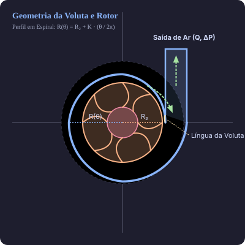

# Voluta

**Matemática e geometria de sopradores centrífugos.**

[](https://github.com/dionarley/voluta/actions/workflows/ci.yml)
[](https://dionarley.github.io/voluta/)
[](https://www.python.org/)
[](https://docs.astral.sh/uv/)
[](LICENSE)
[](tests/)

Projeto de referência para a geometria e o dimensionamento preliminar de
**sopradores centrífugos**. Reúne as equações de turbomáquinas do documento
[Matemática dos Sopradores](docs/assets/matematica-dos-sopradores.pdf) em uma
biblioteca Python testável, uma CLI e documentação com as fórmulas.

O nome **Voluta** vem da carcaça em espiral do soprador, responsável por
converter a energia cinética do ar em pressão estática.



## O que o projeto faz

- Traça a **voluta em espiral de Arquimedes**: `R(θ) = R₂ + K · θ / 2π`.
- Calcula **triângulo de velocidades**, equação de Euler e velocidade periférica.
- Dimensiona **diâmetros de entrada e saída**, largura de pá e potência no eixo.
- Aplica as **leis de afinidade** para mudança de rotação e diâmetro.
- Gera **imagens** do perfil da voluta em PNG, SVG ou PDF.
- Oferece uma **CLI** (`voluta plot` e `voluta design`) e uma API Python.

> O dimensionamento implementado é preliminar. Perdas, curvas reais do rotor,
> seleção de motor, resistência mecânica e ruído devem ser verificados em um
> projeto de engenharia completo.

## Requisitos

- Python 3.10 ou superior
- [uv](https://docs.astral.sh/uv/) para instalação e execução

Instale o `uv`, caso ainda não tenha:

```bash
curl -LsSf https://astral.sh/uv/install.sh | sh
```

## Instalação

```bash
git clone https://github.com/dionarley/voluta.git
cd voluta
uv sync
```

O comando cria o ambiente virtual em `.venv/`, instala o pacote em modo
editável e baixa as dependências de desenvolvimento e documentação.

## Início rápido

Gerar a imagem padrão da voluta:

```bash
uv run voluta plot --output voluta.png
```

Dimensionar um soprador com vazão de `0,5 m³/s`, elevação de pressão de
`1.200 Pa` e rotação de `3.000 RPM`:

```bash
uv run voluta design --flow 0.5 --pressure 1200 --rpm 3000
```

Saída em JSON, útil para scripts:

```bash
uv run voluta design --flow 0.5 --pressure 1200 --rpm 3000 --json
```

Também é possível executar como módulo:

```bash
uv run python -m voluta --help
```

## Uso como biblioteca

```python
from voluta import design_blower, plot_volute, volute_profile

# Perfil geométrico da voluta
perfil = volute_profile(r2=100.0, k=25.0, turns=1.5)
print(perfil.outlet_radius)  # 137.5

# Imagem do perfil
plot_volute(perfil, output="voluta.png", dpi=150)

# Dimensionamento preliminar (SI: m³/s, Pa, RPM)
projeto = design_blower(
    flow_rate_m3_s=0.5,
    pressure_rise_pa=1200.0,
    rpm=3000.0,
    pressure_coefficient=0.6,
    inlet_velocity_m_s=20.0,
    efficiency=0.7,
)
print(f"D2 = {projeto.outlet_diameter_mm:.1f} mm")
print(f"Potência = {projeto.shaft_power_kw:.2f} kW")
```

Consulte [docs/uso.md](docs/uso.md) para todos os comandos e exemplos.

## Equações implementadas

| Grandeza | Equação | Função |
| --- | --- | --- |
| Velocidade periférica | `U = π D N / 60` | `peripheral_velocity` |
| Pressão teórica (Euler) | `ΔP_th = ρ (U₂ C_u2 − U₁ C_u1)` | `euler_pressure` |
| Diâmetro de saída | `U₂ = √(2 ΔP / (ρ ψ))`, `D₂ = 60 U₂ / (π N)` | `outlet_diameter` |
| Diâmetro de entrada | `D₁ = √(4 Q / (π C_1m))` | `inlet_diameter` |
| Largura da pá | `b = Q / (π D C_m)` | `blade_width` |
| Potência no eixo | `P = Q ΔP / η` | `shaft_power` |
| Voluta | `R(θ) = R₂ + K θ / 2π` | `volute_radius` |
| Leis de afinidade | `Q ∝ N D³`, `ΔP ∝ N² D²`, `P ∝ N³ D⁵` | `affinity_*` |

A dedução e as hipóteses estão em [docs/matematica.md](docs/matematica.md).

## Estrutura do projeto

```text
.
├── .github/workflows/ci.yml    # integração contínua
├── docs/                       # documentação MkDocs
│   ├── assets/                 # PDF original e SVG da voluta
│   ├── api.md
│   ├── index.md
│   ├── matematica.md
│   ├── referencias.md
│   └── uso.md
├── examples/                   # scripts de exemplo
├── src/voluta/                 # código-fonte do pacote
│   ├── aero.py                 # equações de dimensionamento
│   ├── cli.py                  # interface de linha de comando
│   ├── geometry.py             # voluta e perfil cartesiano
│   └── plots.py                # visualização com matplotlib
├── tests/                      # testes com pytest
├── LICENSE                     # licença MIT
├── pyproject.toml              # metadados, dependências e ferramentas
├── README.md
└── uv.lock                     # resolução reproduzível do uv
```

## Desenvolvimento

```bash
uv sync                     # instala dependências
uv run pytest               # executa os testes
uv run pytest --cov         # testes com cobertura
uv run ruff check .         # análise estática
uv run ruff format --check .  # verifica formatação
```

Gerar a documentação localmente:

```bash
uv run mkdocs serve
```

Acesse <http://127.0.0.1:8000>. Para validar o build:

```bash
uv run mkdocs build --strict
```

## Documentação

Documentação publicada: **https://dionarley.github.io/voluta/**

- [Visão geral](docs/index.md)
- [Matemática](docs/matematica.md)
- [Uso e API](docs/uso.md)
- [Referência da API](docs/api.md)
- [Referências](docs/referencias.md)

## Licença

Distribuído sob a licença **MIT**. Consulte [LICENSE](LICENSE).
