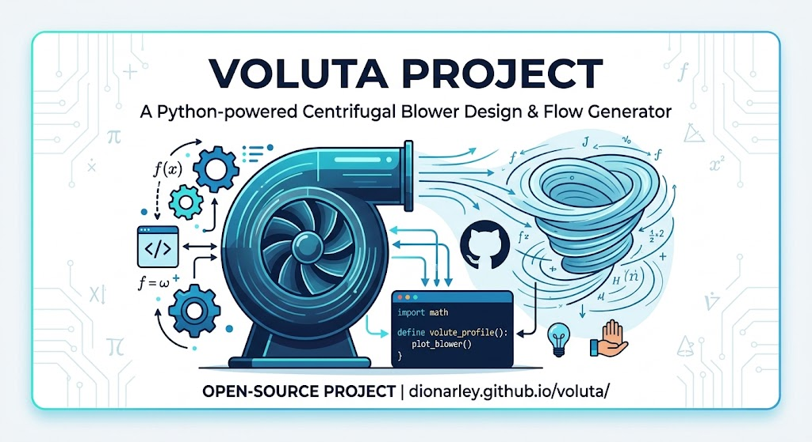
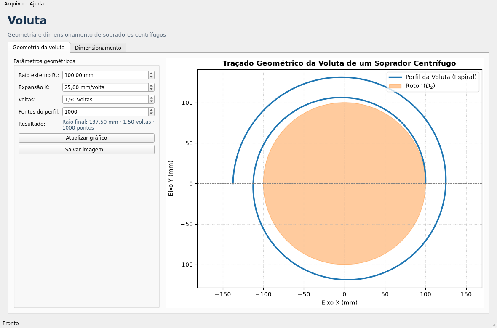
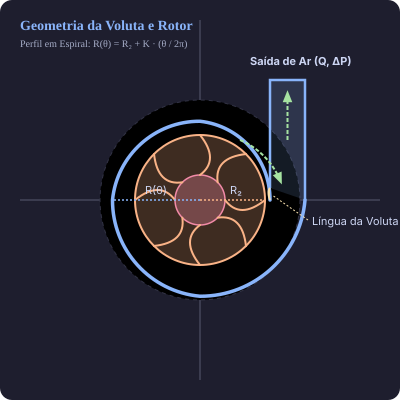

# Voluta

Bem-vindo ao projeto **Voluta**. Este repositório transforma as equações de um
soprador centrífugo em código Python reproduzível, testado e documentado. O
nome vem da voluta, a carcaça em espiral que converte velocidade em pressão.



## Objetivo

O projeto cobre três frentes:

1. **Geometria**: traçado da voluta em espiral de Arquimedes e do rotor.
2. **Dimensionamento**: velocidade periférica, equação de Euler, diâmetros,
   largura de pá, potência no eixo e leis de afinidade.
3. **Interface**: aplicação desktop em Qt (PySide6) com pré-visualização e
   calculadora integrada.

### Interface gráfica



```bash
uv sync --group gui
uv run voluta gui
```

### Perfil gerado pelo projeto



As unidades de cálculo são as do SI (`m`, `m³/s`, `Pa`, `W`, `RPM`). A geometria
da voluta pode usar milímetros, como no exemplo original (`R₂ = 100 mm`).

## Instalação

```bash
uv sync
```

Também há binários standalone para Linux, macOS e Windows em
[GitHub Releases](https://github.com/dionarley/voluta/releases/latest).

## Exemplo rápido

```bash
uv run voluta plot --output voluta.png
uv run voluta design --flow 0.5 --pressure 1200 --rpm 3000
```

## Navegação

- [Matemática](matematica.md): dedução das equações usadas no código.
- [Uso](uso.md): CLI, API Python e exemplos.
- [API](api.md): referência gerada a partir das docstrings.
- [Referências](referencias.md): documento original e leituras sugeridas.

## Código-fonte

O projeto é aberto e o código está disponível no GitHub:

[Ver código-fonte no GitHub](https://github.com/dionarley/voluta){ .md-button .md-button--primary }

## Licença

MIT. Consulte o arquivo `LICENSE` no repositório.
