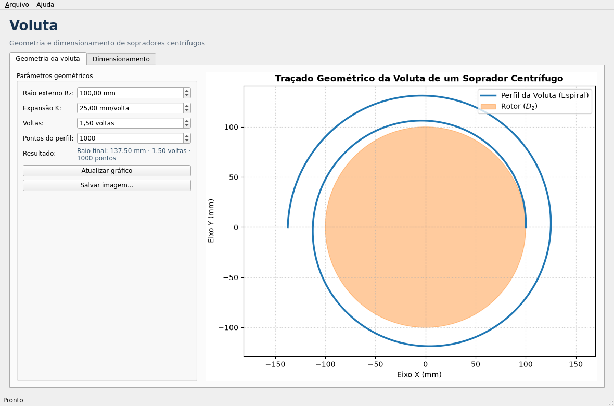

# Uso

## Instalação

```bash
uv sync
```

O `uv` cria o ambiente `.venv` e instala o projeto em modo editável, além das
dependências de desenvolvimento e documentação.

## Binários

A cada tag `v*`, o workflow **Binaries** gera executáveis standalone e publica
no [GitHub Releases](https://github.com/dionarley/voluta/releases/latest).

| Plataforma | Arquivo |
| --- | --- |
| Linux x86_64 | `voluta-linux-x86_64` |
| macOS Intel | `voluta-macos-x86_64` |
| macOS Apple Silicon | `voluta-macos-arm64` |
| Windows x86_64 | `voluta-windows-x86_64.exe` |

Para Linux, também há um bundle Flatpak independente de distribuição. Veja
[Flatpak](flatpak.md).

Linux e macOS:

```bash
chmod +x voluta-linux-x86_64
./voluta-linux-x86_64 --version
```

Windows:

```powershell
.\voluta-windows-x86_64.exe --version
```

Os executáveis são gerados com PyInstaller e não são assinados digitalmente.
No macOS, remova a quarentena se necessário:

```bash
xattr -d com.apple.quarantine voluta-macos-arm64
```

## Interface gráfica (Qt)

A interface usa **PySide6** e matplotlib. Ela permite ajustar os parâmetros da
voluta, visualizar o perfil, calcular o dimensionamento e exportar os
resultados.

```bash
uv sync --group gui
uv run voluta gui
```



Recursos:

- pré-visualização do perfil da voluta em tempo real;
- controles para `R₂`, `K`, voltas e número de pontos;
- calculadora de dimensionamento com `Q`, `ΔP`, `N`, `ρ`, `ψ`, `C₁m` e `η`;
- exportação da imagem em PNG, SVG ou PDF;
- exportação do dimensionamento em JSON.

Os binários publicados em [Releases](https://github.com/dionarley/voluta/releases/latest)
já incluem a interface gráfica.

### NixOS

O wheel do PySide6 não inclui bibliotecas de sistema como `libGL`, `xcb`,
`libX11` e `dbus`. Use o `shell.nix` do repositório:

```bash
nix-shell --run 'uv run voluta gui'
```

## Linha de comando

### `voluta plot`

Gera o traçado da voluta e do rotor.

```bash
uv run voluta plot --output voluta.png
```

Parâmetros disponíveis:

| Opção | Padrão | Descrição |
| --- | --- | --- |
| `--r2` | `100.0` | Raio externo do rotor |
| `--k` | `25.0` | Expansão da voluta por volta |
| `--turns` | `1.5` | Número de voltas do traçado |
| `--samples` | `1000` | Quantidade de pontos do perfil |
| `--output` | `voluta.png` | Arquivo de saída |
| `--dpi` | `150` | Resolução da imagem |
| `--title` | título padrão | Título personalizado |
| `--show` | desativado | Abre a janela interativa |

Exemplo com SVG e quatro voltas:

```bash
uv run voluta plot --turns 4 --samples 2000 --output voluta.svg
```

### `voluta design`

Calcula um dimensionamento preliminar.

```bash
uv run voluta design --flow 0.5 --pressure 1200 --rpm 3000
```

Saída:

```text
Dimensionamento do soprador centrífugo
======================================
Vazão .................... 0.5000 m³/s
Elevação de pressão ...... 1200.0 Pa
Rotação .................. 3000.0 RPM
Velocidade periférica .... 57.74 m/s
Diâmetro de saída ........ 367.6 mm
Diâmetro de entrada ...... 178.4 mm
Potência no eixo ......... 0.857 kW
Eficiência adotada ....... 70.00%
```

Parâmetros:

| Opção | Padrão | Unidade | Descrição |
| --- | --- | --- | --- |
| `--flow` | obrigatório | m³/s | Vazão volumétrica |
| `--pressure` | obrigatório | Pa | Elevação de pressão total |
| `--rpm` | obrigatório | RPM | Rotação |
| `--rho` | `1.2` | kg/m³ | Massa específica do ar |
| `--psi` | `0.6` | – | Coeficiente de pressão |
| `--inlet-velocity` | `20.0` | m/s | Velocidade meridional na entrada |
| `--efficiency` | `0.7` | – | Eficiência global |
| `--json` | desativado | – | Saída em JSON |

Exemplo em JSON:

```bash
uv run voluta design \
  --flow 0.5 --pressure 1200 --rpm 3000 \
  --psi 0.65 --efficiency 0.72 --json
```

## API Python

### Geometria da voluta

```python
import numpy as np

from voluta import volute_profile, volute_radius

# Raio em um ângulo qualquer (radianos)
raio = volute_radius(np.pi, r2=100.0, k=25.0)
print(float(raio))  # 112.5

# Perfil completo
perfil = volute_profile(r2=100.0, k=25.0, turns=1.5, samples=1000)
print(perfil.outlet_radius)  # 137.5
print(perfil.turns)  # 1.5
```

### Imagem

```python
from voluta import plot_volute, volute_profile

perfil = volute_profile(r2=100.0, k=25.0, turns=1.5)
plot_volute(perfil, output="voluta.png", dpi=150)
```

Formatos suportados dependem do matplotlib: PNG, SVG, PDF, EPS e outros.

### Dimensionamento

```python
from voluta import design_blower

projeto = design_blower(
    flow_rate_m3_s=0.5,
    pressure_rise_pa=1200.0,
    rpm=3000.0,
    rho=1.2,
    pressure_coefficient=0.6,
    inlet_velocity_m_s=20.0,
    efficiency=0.7,
)

print(f"Velocidade periférica: {projeto.tip_speed_m_s:.2f} m/s")
print(f"D2: {projeto.outlet_diameter_mm:.1f} mm")
print(f"D1: {projeto.inlet_diameter_mm:.1f} mm")
print(f"Potência: {projeto.shaft_power_kw:.3f} kW")
```

### Equações individuais

```python
from voluta import (
    affinity_flow,
    affinity_power,
    affinity_pressure,
    blade_width,
    euler_pressure,
    peripheral_velocity,
    shaft_power,
)

u2 = peripheral_velocity(diameter_m=0.3676, rpm=3000.0)
dp = euler_pressure(u2=u2, c_u2=0.9 * u2, rho=1.2)
b2 = blade_width(flow_rate_m3_s=0.5, diameter_m=0.3676, meridional_velocity_m_s=10.0)
p = shaft_power(flow_rate_m3_s=0.5, pressure_rise_pa=1200.0, efficiency=0.7)

q_novo = affinity_flow(0.5, speed_ratio=1.2)
dp_novo = affinity_pressure(1200.0, speed_ratio=1.2)
p_novo = affinity_power(p, speed_ratio=1.2)
```

## Exemplos prontos

```bash
uv run python examples/plot_voluta.py
```

O script gera `examples/voluta.png`. O arquivo
`examples/legacy_shape_soprador.py` preserva o script original do documento,
sem alterações.

## Testes e qualidade

```bash
uv run pytest
uv run pytest --cov
uv run ruff check .
uv run ruff format --check .
```

## Documentação

```bash
uv run mkdocs serve
```

Para validar o build como na integração contínua:

```bash
uv run mkdocs build --strict
```
